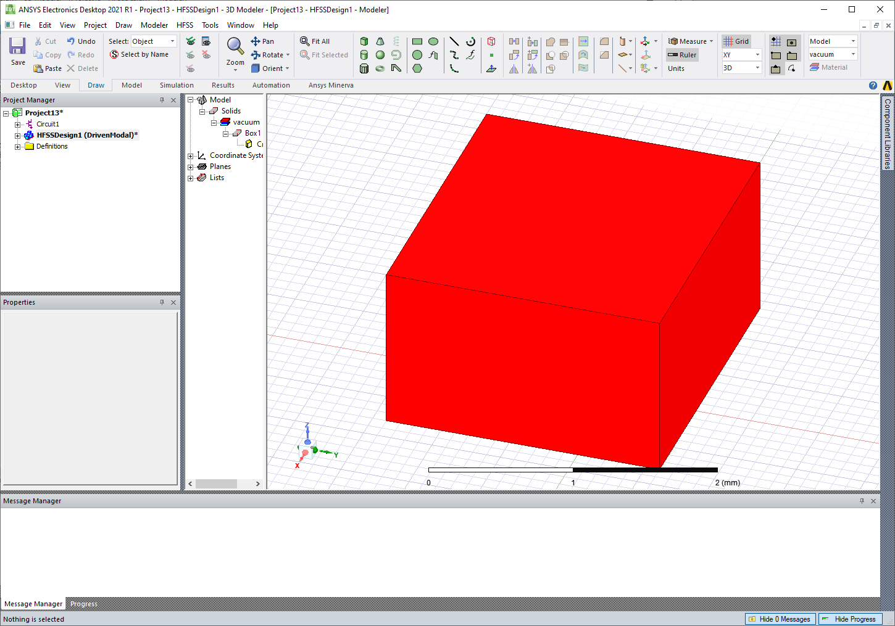

Modeler
=======
The AEDT 3D and 2D Modelers use object-oriented programming to create and manage objects.
You can use getters and setters to create an object and change its properties.

The following code creates a box and changes the color to red:

.. code:: python

     from ansys.aedt.core.hfss import Hfss

     hfss = Hfss()
     box = hfss.modeler.create_box(
         origin=[0, 0, 0], sizes=[10, 10, 10], name="mybox", material="aluminum"
     )
     print(box.faces)
     box.color = "Red"

Similarly, you can change other properties, such as the material and transparency.

.. code:: python

    from ansys.aedt.core.hfss import Hfss

    app = Hfss()
    box = app.modeler.create_box(origin=[0, 0, 0], sizes=[100, 100, 20], name="mybox")
    box.material_name = "copper"
    box.transparency = 0.4
    print(box.material_name)

Once an object is created or is present in the design (from a loaded project), you can
use a getter to get the related object. A getter works either with an object ID or
object name. The object returned has all features, even if it has not been created in PyAEDT.

This example shows how easily you can go deeper into edges and vertices of faces or 3D objects:

.. code:: python

     from ansys.aedt.core.hfss import Hfss

     app = Hfss()
     box = app.modeler.create_box(origin=[0, 0, 0], sizes=[100, 100, 20], name="mybox")
     for face in box.faces:
         print(face.center)
         for edge in face.edges:
             print(edge.midpoint)
             for vertice in edge.vertices:
                 print(vertice.position)
     for vertice in box.vertices:
         print(vertice.position)

All objects support executing any modeler operation, such as union or subtraction:

.. code:: python

     from ansys.aedt.core.hfss import Hfss
     from ansys.aedt.core.generic.constants import Axis

     app = Hfss()
     app.modeler.create_box(origin=[0, 0, 0], sizes=[100, 100, 20], name="mybox2")
     app.modeler.create_cylinder(
         orientation=Axis.Z, origin=[0, 0, -1], radius=1, height=22, name="mycyl"
     )
     box = app.modeler["mybox2"]
     cyl = app.modeler["mycyl"]
     box.unite(cyl)
     box.subtract(cyl)

Batch geometry operations for large models
-----------------------------------------

When you perform a group of geometry edits that repeatedly create, delete, or replace objects,
wrap the operations in ``with modeler.batch_geometry_operations():`` to defer object cleanup until
all operations in the batch complete. This is especially useful for large geometries because it
reduces the overhead of repeated refresh and cleanup calls while several modeler operations are
executed in sequence.

.. code:: python

     from ansys.aedt.core.hfss import Hfss
     from ansys.aedt.core.generic.constants import Axis

     app = Hfss()
     target = app.modeler.create_box(origin=[0, 0, 0], sizes=[100, 100, 20])
     cutters = app.modeler.create_cylinder(
         orientation=Axis.Z, origin=[0, 0, -1], radius=1, height=22
     )
     with app.modeler.batch_geometry_operations():
         for cutter in cutters:
             app.modeler.subtract(target.name, cutter.name, keep_originals=False)
             app.modeler.unite(target.name, cutter.name)

This pattern improves performance when processing many Boolean operations, such as repeated cuts,
joins, or intersections over the same design.
