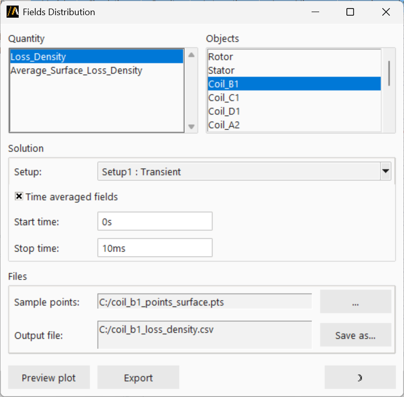

Fields distribution
===================

This extensions allows to export fields distribution in generic formats such as CSV, TAB, or NPY on a defined grid of points or on mesh nodes.

The extension works with Maxwell 2D and Maxwell 3D designs, for both frequency domain and all transient solution types.

You can access the extension from the icon created on the **Automation** tab using the Extension Manager.

The following image shows the extension user interface for a transient design:

The user interface is organized in the following sections:

- **Quantity**: Select the field to export. This list displays all the available named expressions in the fields calculator.
- **Objects**: Select one or more objects on which the field is exported.
- **Solution**: Select the setup and sweep in the **Setup** drop-down list. The list contains all the analysis sweeps
  of the design, so you can switch between them when the design has more than one setup.
  For transient designs, this section also contains the time settings described in the next section.
- **Files**: Specify the sample points file and the output file.

Transient designs
-----------------

For transient designs, you can export either the instantaneous field at a given time or the field averaged over a time range:

- **Instantaneous field**: Leave the **Time averaged fields** check box cleared and provide the **Time** value,
  with units, such as ``10ms``. The field is exported at this time step.
- **Time averaged field**: Select the **Time averaged fields** check box and provide both the **Start time**
  and the **Stop time**, with units, such as ``0s`` and ``10ms``. The field is averaged over the time
  steps between these two values. Both values are required.

The **Quantity** list changes dynamically with the **Time averaged fields** check box. When the check box is selected,
the list displays only the time averaged named expressions available in the fields calculator.
When it is cleared, the list displays the instantaneous named expressions again.
The **Start time** field is visible only when the check box is selected, and the **Time** field is renamed **Stop time**.

Files
-----

The **Sample points** field is optional:

- If it is empty, the field is exported on the mesh nodes of the surfaces of the selected objects,
  or of all objects if no object is selected.
- To export the field on a given set of points instead, click the browse button next to the field and select an existing PTS file.

To create a sample points file, first run the :doc:`../project/point_cloud_generator` extension
on the objects of interest. It generates a PTS file with a point cloud conforming to the selected objects.
Then, select the resulting PTS file in the **Sample points** field of the Fields distribution extension.

In the **Output file** field, the **Save as** button allows to browse the location to save the output file
in the selected format (CSV, TAB, or NPY).

Finally, the **Export** button exports the field to the desired location both in the selected format and as a FLD file.

You can also launch the extension user interface from the terminal. An example can be found here:

.. toctree::
   :maxdepth: 2

   ../commandline